# avl-tree

[](https://github.com/ritesh7766/avl_tree/actions/workflows/ci.yml)
[](LICENSE)
[](https://www.python.org/downloads/)
[](https://mypy-lang.org/)

A lightweight, strictly typed AVL tree implementation in Python with zero runtime dependencies. Every insertion and deletion preserves the AVL height invariant ($\lvert\text{balance factor}\rvert \le 1$), guaranteeing **$O(\log n)$** worst-case time complexity.

- **Functional API** — `insert` and `delete` return the updated root node; always reassign the returned reference.
- **Strictly Typed** — Passes `mypy --strict` out of the box.
- **Zero Dependencies** — Pure Python standard library (`dataclasses`).

---

## Quick Start

### Installation

```bash
git clone [https://github.com/ritesh7766/avl_tree.git](https://github.com/ritesh7766/avl_tree.git)
cd avl_tree
pip install -e .
```

### Usage

```python
from avl_tree import Node, delete, insert, pre_order

root: Node | None = None
for value in [10, 20, 30, 40, 50, 25]:
    root = insert(root, value)

root = delete(root, 10)
pre_order(root)
```

---

## How It Works

### 1. Single & Double Rotations

When an update pushes a node's balance factor (`height(left) - height(right)`) outside `[-1, 0, 1]`, the tree rebalances locally in $O(1)$ time:

- **Single Rotation (`LL` / `RR`)** — Child leans in the same direction as the imbalance.
- **Double Rotation (`LR` / `RL`)** — Child leans in the opposite direction (zigzag), requiring a child rotation first to straighten the path before rotating the root.

<p align="center">
  
</p>

### 2. Insertion (`insert`)

Inserting `25` into `[10, 20, 30, 40, 50]` creates a **Right-Left** imbalance at `20` (`bf = -2`, right child `40` has `bf = +1`), triggering `right_rotate(40)` followed by `left_rotate(20)`:

<p align="center">
  
</p>

### 3. Deletion (`delete`)

Removing a node updates subtree heights bottom-up and triggers rotations if an ancestor becomes unbalanced (two-child nodes are replaced by their in-order successor first):

<p align="center">
  
</p>

---

## Complexity & API Reference

| Operation | Average | Worst Case | Space |
| :--- | :---: | :---: | :---: |
| **Search / Traversal** | $O(\log n)$ | $O(\log n)$ | $O(\log n)$ |
| **Insert** | $O(\log n)$ | $O(\log n)$ | $O(\log n)$ |
| **Delete** | $O(\log n)$ | $O(\log n)$ | $O(\log n)$ |

### Public Functions

| Symbol | Signature | Description |
| :--- | :--- | :--- |
| `Node` | `Node(val, left=None, right=None, height=1)` | Dataclass representing a node and its cached subtree height. |
| `insert` | `insert(root: Node \| None, val: int) -> Node` | Inserts `val` (ignoring duplicates) and returns the rebalanced root. |
| `delete` | `delete(root: Node \| None, val: int) -> Node \| None` | Removes `val` if present and returns the rebalanced root (or `None`). |
| `height` | `height(node: Node \| None) -> int` | Returns the cached height of `node` (`0` if `None`). |
| `balance_factor` | `balance_factor(node: Node \| None) -> int` | Returns `height(left) - height(right)`. |
| `pre_order` | `pre_order(root: Node \| None) -> None` | Prints node values in pre-order (`node -> left -> right`). |

---

## Development

```bash
pip install -e ".[dev]"

ruff check . && ruff format --check .   # lint and formatting
mypy                                    # strict type checking
pytest --cov                            # tests with coverage
```

## License

This project is licensed under the [MIT License](LICENSE).
